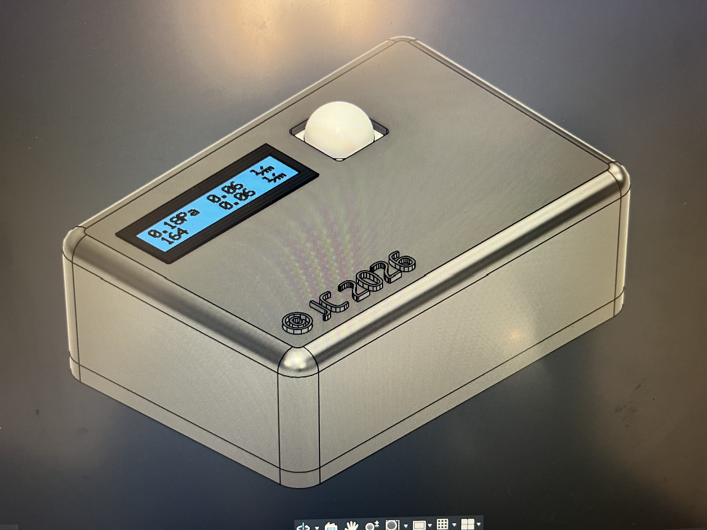

# Automated-temp-monitoring-box

Research product that I got commissioned to design, code, and assemble. Uses a motion sensor to detect when someone enters a room, scans the temperature of the room, then gives a verdict whether to decrease or increase temperature.


## Table of Contents

- [Overview](#overview)
- [Hardware](#hardware)
- [Software](#software)
- [Credits](#credits)
- [Contact](#contact)

## Overview

ATMB (Automated Temperature Monitoring Box) is an embedded sensor system that detects when someone enters a room, scans the temperature of the room, then gives a verdict whether to decrease or increase temperature. It works by using an Arduino Uno R3 microcontroller dev-board paired with a motion sensor and temperature sensor to detect movement and temperature inside the room. A servo sweeps the temp sensor left to right and sends 3 temperature readings to the Arduino. The Arduino then calculates the average reading and compares it to the hard-coded ranges to give the verdict. The average temperature and verdict are displayed through an LCD screen.

### Design Decisions

- Original materials provided by client included a relay, removed because it was unnecessary (The Arduino's 5V pin is within the other components’ ratings, so the relay wasn’t needed).
- Used a 3D printed case, as opposed to the plastic box, to allow customizability and perfect fit of components.

### Technical Highlights

- Designed the sensor layout and wiring with the client during the build session.
- Wrote code in C++ handling servo control, sensor inputs, and display outputs.
- Built and assembled a 3D printed enclosure using Fusion360.

## Hardware

<p align="center">
  <br>
  <em>Designed in Autodesk Fusion360</em>
</p>

### Bill of Materials

| Part | Qty | Link |
|------|-----|--------------|
| Arduino Uno R3 | 1 | https://www.voltaat.com/collections/arduino-compatible/products/voltaat-uno-r3-board |
| SG90 Micro Servo | 1 | https://www.voltaat.com/collections/servos/products/sg90-servo |
| HC-SR501 PIR Motion Sensor | 1 | https://www.voltaat.com/collections/motion/products/hc-sr501-pir-motion-sensor-with-adjustable-sensitivity-delay |
| DHT11 Digital Temperature Sensor | 1 | https://www.voltaat.com/collections/temperature/products/dht11-temperature-humidity-sensor |
| 2x16 LCD Screen with I2C Module | 1 | https://www.voltaat.com/collections/displays/products/2x16-lcd-with-i2c-module |
| Passive buzzer | 1 | https://www.voltaat.com/collections/displays/products/buzzer |
| Jumper wires and breadboard | As needed | N/A |
| 3D-printed enclosure | 1 | N/A |

#### Fasteners

| Fastener | Qty | Location |
|----------|-----|----------|
| M2 screw | 8 | Enclosure, Motion sensor, servo motor |
| M3 screw | 4 | LCD Screen |
| M4 screw | 4 | Arduino Uno R3 |

*(All parts were locally sourced)*

### Tools Required

- Screwdriver, 3D printer, Hand Drill, Power Supply (for Arduino Uno)

> **Note:** Servo runs on power from Arduino's 5v pin, future iterations could include a 5v supply dedicated to the servo.

### Wiring

#### Wiring Diagram


#### Real-life wiring


#### Pinout

| Arduino pin | Connects to | Function |
|-------------|-------------|----------|
| D6 | PIR OUT | Motion detect (digital input) |
| D7 | DHT11 DATA | Temperature and humidity data |
| D9 | Servo signal (yellow or orange wire) | PWM position control |
| D4 | Buzzer + | Tone output |
| A4 (SDA) | LCD SDA | I2C data |
| A5 (SCL) | LCD SCL | I2C clock |
| 5V | PIR VCC, DHT11 VCC, LCD VCC, buzzer, servo VCC | Power |
| GND | All GND pins, buzzer − | Common ground |

## Software

The firmware is written in C++ for the Arduino IDE. It waits for motion, sweeps the temperature sensor across the room, averages three readings, and shows a verdict on the LCD.

### Requirements

- [Arduino IDE](https://www.arduino.cc/en/software) 2.x or later
- Arduino Uno R3 (or compatible board)
- Libraries (install via Library Manager):
  - `LiquidCrystal_I2C` by Frank de Brabander
  - `DHT sensor library` by Adafruit (also install its dependency, `Adafruit Unified Sensor`, when prompted)
  - `Servo` and `Wire` are included with the Arduino IDE

### Installation

1. Clone the repository:
```bash
   git clone https://github.com/username/Automated-temp-monitoring-box.git
```
2. Open `software/ATMB.ino` in the Arduino IDE.
3. Select **Tools → Board → Arduino Uno** and the correct port under **Tools → Port**.
4. Click **Upload**.

### Configuration

Settings are defined as constants at the top of the sketch:

| Constant | Default | Description |
|----------|---------|-------------|
| `SERVO_LEFT` / `SERVO_RIGHT` | 0 / 180 | Sweep range in degrees |
| `SWEEP_COUNT` | 3 | Number of sweeps per reading |
| `STEP_DELAY` | 15 | Milliseconds between each servo step (lower is faster) |
| `BUZZ_FREQ` / `BUZZ_MS` | 2000 / 3000 | Buzzer tone frequency and duration |

The temperature thresholds are set inside `displayAverage()`:
- Below 20 °C: "COLD - Set higher"
- Above 25 °C: "HOT - Set lower"
- Otherwise: "WARM - OK"

The LCD is assumed to be at I2C address `0x27`. If your display doesn't respond, run an I2C scanner sketch to find the correct address and update `LiquidCrystal_I2C lcd(0x27, 16, 2);`.

### How It Works

1. **Idle:** The LCD shows "Waiting for motion..." while the PIR sensor is LOW.
2. **Trigger:** When the PIR sensor goes HIGH, the servo sweeps left to right and back `SWEEP_COUNT` times. The DHT11 is read at the far right position on each sweep.
3. **Average:** Valid readings are averaged. If every read fails, the LCD shows "Sensor error."
4. **Verdict:** The average and verdict appear on the LCD, and the buzzer plays an alert pattern.
5. **Re-arm:** The code waits until motion clears before it can trigger again. The result stays on screen until the next trigger.

### Troubleshooting

- **LCD blank:** Check the I2C address, and confirm SDA is on A4 and SCL on A5.
- **Servo jitters or the board resets:** The servo shares the Uno's 5V pin. Try an external 5V supply with a shared ground.

## Credits

- Commissioned by Jared Honrado
- Libraries, tutorials, and Anthropic's Claude for assisting with the code

## Contact

*LinkedIn:* www.linkedin.com/in/jared-caldo-1086653a9 

*Email:* jaredcaldo@proton.me 
