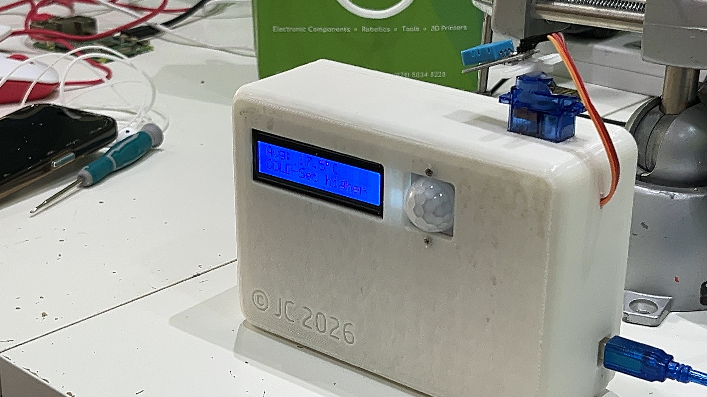
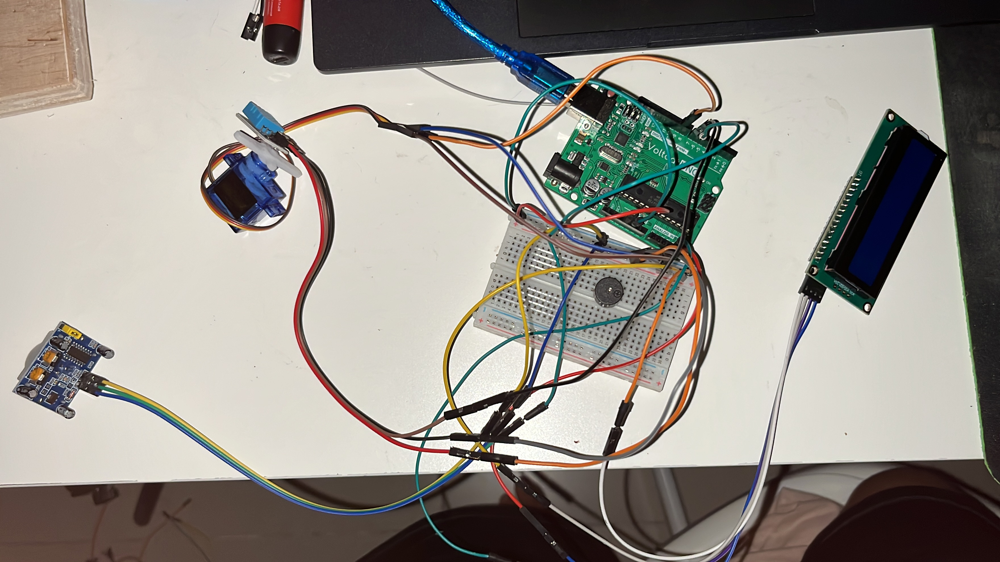

# Automated-temp-monitoring-box
Research product that I got commissioned to design, code, and assemble. Uses a motion sensor to detect when someone enters a room, scans the temperature of the room, then gives a verdict whether to decrease or increase temperature.  
   

## Table of Contents
- [Overview](#overview)
- [Hardware](#hardware)
- [Software](#software)
- [Credits](#credits)
- [Contact](#contact)

## Overview
ATMB (Automated Temperature Monitoring Box) is an embedded sensor system that detects when someone enters a room, scans the temperature of the room, then gives a verdict whether to decrease or increase temperature. It works by using an Arduino Uno R3 microcontroller dev-board paired with a motion sensor and temperature sensor to detect movement and temperature inside the room. A servo sweeps the temp sensor left to right and sends 3 temperature readings to the Arduino. The Arduino then calculates the average reading and compares it to the hard-coded ranges to give the verdict. The average temperature and verdict are displayed through an LCD screen.

### Design Decisions
- **[Choice]:** Original materials provided by client included a relay, removed because it was unnecessary (The Arduino's 5V pin is within the components’ ratings, so the relay wasn’t needed)
- **[Choice]:** Used a 3D printed case, as opposed to the plastic box, to allow customizability and perfect fit of components

### Technical Highlights
- Designed the sensor layout and wiring with the client during the build session.
- Wrote code in C++ handling servo control, sensor inputs, and display outputs.
- Built and assembled a 3D printed enclosure using Fusion360.

## Hardware

### Bill of Materials
| Part | Qty | Link |
|------|-----|--------------|
| Arduino Uno R3 | 1 | https://www.voltaat.com/collections/arduino-compatible/products/voltaat-uno-r3-board |
| SG90 Micro Servo | 1 | https://www.voltaat.com/collections/servos/products/sg90-servo |
| HC-SR501 PIR Motion Sensor | 1 | https://www.voltaat.com/collections/motion/products/hc-sr501-pir-motion-sensor-with-adjustable-sensitivity-delay |
| DHT11 Digital Temperature Sensor | 1 | https://www.voltaat.com/collections/temperature/products/dht11-temperature-humidity-sensor |
| 2x16 LCD Screen with I2C Module | 1 | https://www.voltaat.com/collections/displays/products/2x16-lcd-with-i2c-module |
| Passive buzzer | 1 | https://www.voltaat.com/collections/displays/products/buzzer |
| Jumper wires and breadboard | As needed | N/A |
| 3D-printed enclosure | 1 | Houses the sensors and servo | N/A |

#### Fasteners
| Fastener | Qty | Location |
|----------|-----|----------|
| M2 screw | 8 | Enclosure, Motion sensor, servo motor |
| M3 screw | 4 | LCD Screen |
| M4 screw | 4 | Arduino Uno R3 |

(All parts were locally sourced)

### Tools Required
- Screwdriver, 3D printer, Hand Drill, Power Supply (for Arduino Uno)

> Note: Servo runs on power from Arduino's 5v pin, future iterations could include a 5v supply dedicated to the servo.

### Wiring
#### Wiring Diagram

#### Real-life wiring

#### Pinout
| Arduino pin |	Connects to |	Function |
|-------------|-------------|----------|
| D6 | PIR OUT | Motion detect (digital input) |
| D7 | DHT11 DATA | Temperature and humidity data |
| D9 | Servo signal (yellow or orange wire) | PWM position control |
| D4 | Buzzer +	| Tone output |
| A4 (SDA) | LCD SDA | I2C data |
| A5 (SCL) | LCD SCL | I2C clock |
| 5V | PIR VCC, DHT11 VCC, LCD VCC, buzzer, servo VCC | Power |
| GND | All GND pins, buzzer − | Common ground |

## Software

### Requirements
- LiquidCrystal_I2C (Frank de Brabander or similar)
- DHT sensor library (Adafruit)
- Servo and Wire are built in

